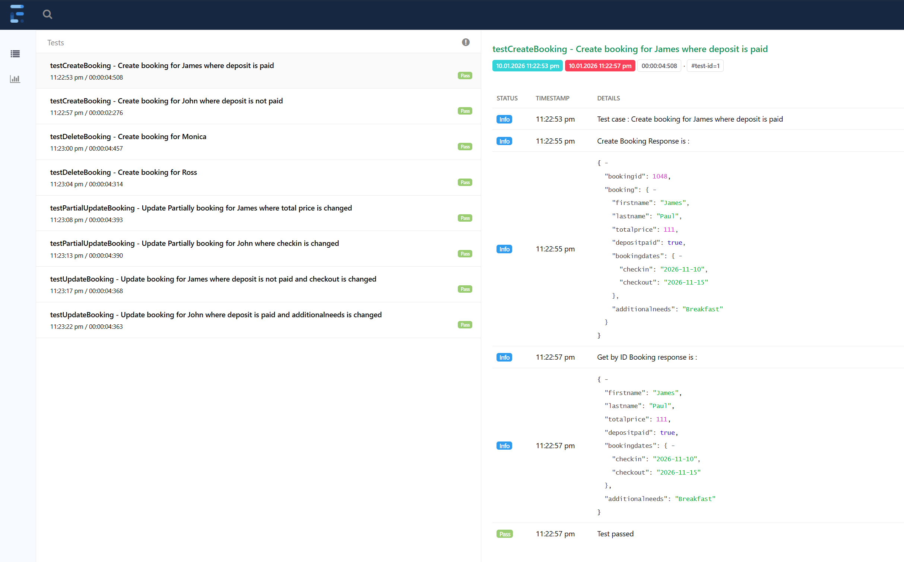

# Restful Booker API Tests

API test automation project for the [Restful Booker](https://restful-booker.herokuapp.com) website.
It is written in Java using REST Assured and TestNG, and the test data comes from an Excel file.

## What it tests

| Flow | Steps | What is checked |
|---|---|---|
| Create booking | Create, then get by ID | The create response matches the expected response, `bookingid` is a number, and get returns the same booking |
| Update booking | Create, get auth token, update, then get by ID | The update response and the get response both show the updated values |
| Partial update booking | Create, get auth token, patch, then get by ID | Only the patched fields change, the rest stay the same |
| Delete booking | Create, get auth token, delete, then get by ID | Delete returns 201, and get afterwards returns 404 (not found) |

Each row in the Excel sheet is one test case. For example, the create sheet has one row for James and one row for John, so two tests run.

## How to run

1. Install Java 17.
2. Open the project folder in a terminal.
3. Run:

```
.\gradlew clean test
```

(On Mac or Linux use `./gradlew clean test`.)

You can also open a test class in IntelliJ and click the green run button.

## Where is the report

After the run, open this file in your browser:

```
build/reports/extent/ExtentReport_<date and time>.html
```

It shows every test with its request, response and pass or fail result.



## How to add a new test case

1. Open `Testdata.xlsx` and add a new row in the sheet you want.
2. Put `Y` in the `Enabled` column.
3. Run the tests again. No code change is needed.

## Tools used

Java 17, Gradle, REST Assured, TestNG, Apache POI (Excel), Extent Reports
